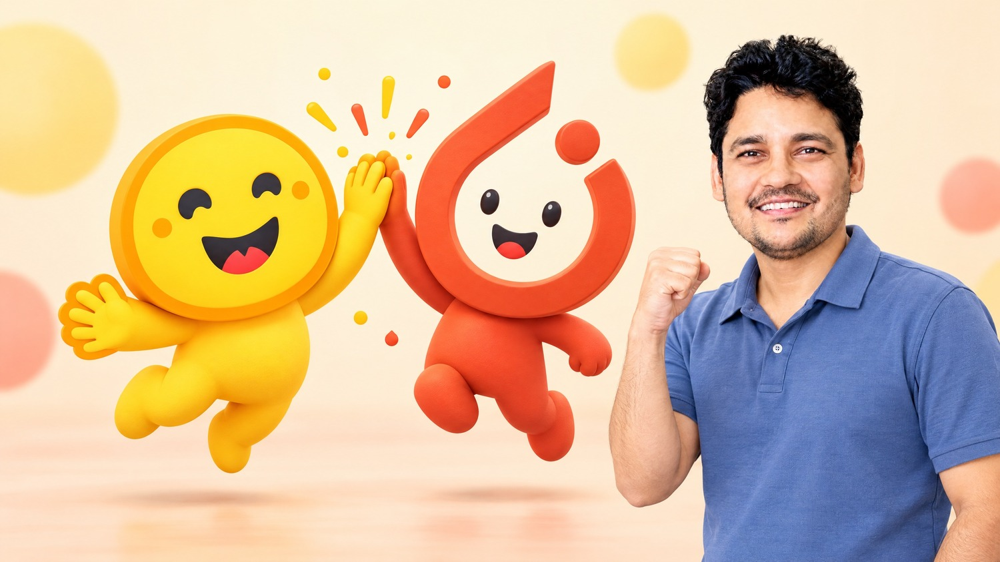

<p align="center">
  <a href="https://kgptalkie.com/decision-ai-llm-fine-tuning">
    
  </a>
</p>

<h1 align="center">Fine-Tuning System One Decision Models</h1>

<p align="center">
  Code, data and cheat sheets for the KGP Talkie course<br>
  <b>Building and Fine-Tuning Decision AI LLM Transformers</b>
</p>

<p align="center">
  <a href="https://kgptalkie.com/decision-ai-llm-fine-tuning"></a>
  <a href="https://huggingface.co/kgptalkie/mini-laya"></a>
</p>

<p align="center">
  
  
  
  
  
  
</p>

<p align="center">
  <a href="#what-you-build">What you build</a> ·
  <a href="#course-map">Course map</a> ·
  <a href="#repository-layout">Layout</a> ·
  <a href="#setup">Setup</a> ·
  <a href="#mini-laya-in-ollama-section-8">Mini Laya in Ollama</a> ·
  <a href="#known-issues">Known issues</a>
</p>

---

System One decision models such as Laya, Kev, tev1, nimble and clef-flash take a state plus typed questions (`choice`, `score`, `noul`) and return calibrated probabilities in a single forward pass, with no text generation. This course starts at the transformer underneath them, fine-tunes Laya on your own data, builds two decision models of your own (Mini Laya on an encoder, Mini Clef on a decoder), and ends by sharing Mini Laya on the Hugging Face Hub and running it in Ollama.

It follows **Jev and Laya Fundamentals**, which covers the Jev API, decision patterns and serving with Ollama.

## What you build

- Self-attention computed step by step, and the encoder and decoder families it powers
- Decision models run locally through Ollama's `/v1/systemone` endpoint, and the same kind of answer read by hand from an LLM's logits
- Laya fine-tuned on one problem statement (routing card messages) with the `laya` package
- **Mini Laya**: ModernBERT-base with Laya's decision head, trained with a proper scoring rule
- A classifier fine-tuned with the Hugging Face `Trainer`, then with LoRA and QLoRA through PEFT, including a 4B model in 4-bit
- **Mini Clef**: Qwen2.5-0.5B with a LoRA adapter and a decision head
- Mini Laya pushed to the Hub with a model card, loaded back by name, and converted to GGUF so Ollama runs it like Laya

## Course map

| Section | Topic | Code | Lab |
|---|---|---|---|
| 1 | Transformers: pipelines, tokens, attention, encoder and decoder, logits, generation | `01_P1`, `01_P2`, `01_P3` | Self-attention step by step |
| 2 | How a System One model decides: decision models on Ollama, answers read from an LLM's logits, calibration, Laya measured with `laya.evals` | `02` | Mistakes made with high confidence |
| 3 | Fine-tuning Laya on one problem statement with `laya`'s `finetune`: routing card messages | `03` | Original vs fine-tuned Laya on new messages |
| 4 | Build your own Mini Laya: ModernBERT plus Laya's decision head, trained with `finetune` and a proper scoring rule | `04` | Fine-tune Mini Laya on custom data |
| 5 | Fine-tuning fundamentals: a new head, freezing, memory per parameter, `Trainer`, learning rate, overfitting | `05` | Accuracy vs learning rate |
| 6 | LoRA, QLoRA and PEFT: adapters, save, load and merge, a 4B model in 4-bit | `06` | Accuracy vs LoRA rank |
| 7 | Build your own Mini Clef: Qwen2.5-0.5B with LoRA and a decision head, trained with `Trainer` | `07` | Laya vs Mini Laya vs Mini Clef on the card task |
| 8 | Share your model: Hub repositories, a model card, uploading from Python, and Mini Laya in Ollama | `ollama/` | Same answers from Python and from Ollama |

## Repository layout

```text
.
├── notebooks/            the code, one notebook per section (run them from this folder)
│   └── data/tickets.csv  the support tickets used in Sections 1 and 2
├── cheatsheets/          a two to five page PDF per notebook, same name as the notebook
├── ollama/               Section 8: write Mini Laya as GGUF and run it in Ollama
│   ├── mini_laya_to_gguf.py
│   ├── Modelfile
│   └── flight.json
├── assets/               the banner at the top of this page
├── pyproject.toml        dependencies (managed with uv)
└── uv.lock
```

Cheat sheets for Sections 5 to 7 are added as they are released.

## Requirements

- Python 3.12 and [uv](https://docs.astral.sh/uv/)
- An NVIDIA GPU for Sections 3 to 7. The course was recorded on an RTX 5090 with 32 GB; the PyTorch wheels come from the CUDA 12.8 index, which RTX 50 series cards need.
- [Ollama](https://ollama.com) for Sections 2 and 8
- A free Hugging Face account and access token

## Setup

Install the dependencies:

```bash
uv sync
```

Sign in to Hugging Face once, so model downloads are not rate-limited. Without it the notebooks still run, but print a warning about unauthenticated requests.

```bash
uv run hf auth login
```

Section 2 runs three decision models through Ollama on port 11434. Pull them once:

```bash
ollama pull tev1
```

```bash
ollama pull nimble
```

```bash
ollama pull clef-flash
```

## Data for Sections 3 to 7

Kev's labelled eval sets come from its repository, cloned into `vendor/` next to `notebooks/`:

```bash
git clone https://github.com/jaredpalmer/kev vendor/kev
```

- The card problem uses Banking77 through its parquet mirror `mteb/banking77`. The original `PolyAI/banking77` uses a loading script that current `datasets` no longer runs.
- Section 3 tests what Laya forgot on Kev's transfer set, and Sections 4 and 7 train on Kev's eval sets in `vendor/kev/evals`. Held-out calibration, test and transfer rows are removed by text hash.
- Run the sections in order. Section 2 writes `notebooks/runs/tickets.jsonl`; Section 3 writes `notebooks/runs/cards` and `notebooks/runs/laya-cards`; Section 4 writes `notebooks/runs/system-one-data`, `notebooks/runs/mini-laya` and `notebooks/runs/mini-laya-cards`; Section 7 reads the data, writes `notebooks/runs/mini-clef`, and its lab compares all of them.

## Mini Laya in Ollama (Section 8)

`ollama/mini_laya_to_gguf.py` writes Mini Laya as one GGUF file in the layout of Ollama's own `laya` build (architecture `modern-bert`, decision type `laya`), so Ollama runs it as a decision model through `/v1/systemone`. Run these from the `ollama/` folder.

Download Mini Laya from the Hub, or point the converter at your own `notebooks/runs/mini-laya`:

```bash
uv run python -c "from huggingface_hub import snapshot_download; snapshot_download('kgptalkie/mini-laya', local_dir='from-hub/mini-laya')"
```

Write the GGUF file (about 314 MB, 16-bit weights):

```bash
uv run python mini_laya_to_gguf.py from-hub/mini-laya mini-laya.gguf
```

Create the model from the `Modelfile` next to it:

```bash
ollama create mini-laya
```

Ask it the flight questions:

```bash
curl http://localhost:11434/v1/systemone -d "@flight.json"
```

- On Windows PowerShell, type `curl.exe`, since `curl` there is a different command.
- Mini Clef does not take this route: Ollama's clef models use a different decision head, so Mini Clef runs in Python with its adapter.

## Known issues

- A notebook cell that displays a loss tensor keeps its autograd graph alive. On a long run this pushes GPU memory into shared system memory and training slows to a crawl. Display `loss.item()` instead.

---

## Author

Laxmi Kant Tiwari, [KGP Talkie](https://kgptalkie.com). Questions about the course go to the Q&A on the course page.
